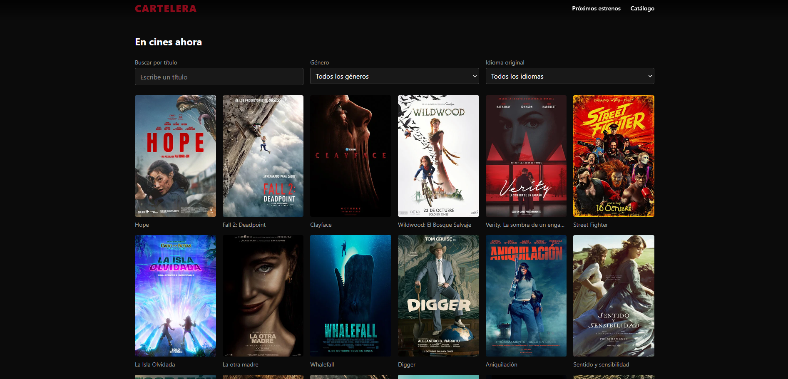
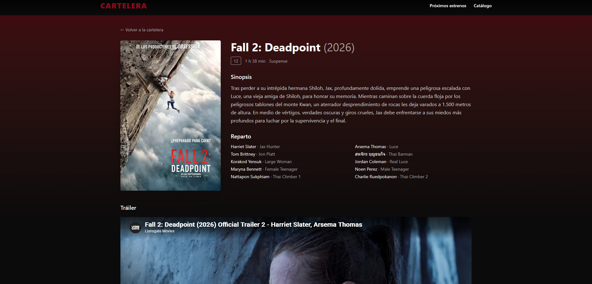

# AgentOS · Cartelera de Cine — Documentación

Repositorio de documentación de la práctica **«Desarrollo de una aplicación mediante SDD asistido por IA»**, del Máster de FP en Inteligencia Artificial y Big Data (CPIFP Alan Turing, Málaga).

> 💻 **El código de la aplicación está en otro repositorio:** [Reysanx/AgentOS_Cartelera_Cine](https://github.com/Reysanx/AgentOS_Cartelera_Cine). Allí se explica el código y cómo ejecutarlo. Este repositorio contiene la documentación, la presentación y las anotaciones de la práctica.

## Equipo

| Nombre |
|---|
| Samuel Fernández Sepúlveda |
| Alexánder Sánchez Jara |
| Lucía González Rosas |

## Descripción de la práctica

El objetivo de la práctica es conocer y aplicar una metodología de **Spec-Driven Development (SDD)**: escribir y revisar primero una especificación y solo después implementarla con ayuda de IA. El objetivo no es medir cuánto código genera la IA, sino aprender a dirigir y supervisar el desarrollo asistido por IA.

Nuestro grupo ha investigado **[Agent OS](https://buildermethods.com/agent-os)** (Brian Casel, Builder Methods), un conjunto de archivos markdown y comandos que se instalan en el proyecto para que el asistente de IA (Claude Code) trabaje de forma ordenada. Se organiza en tres capas:

- **Standards**: cómo se construye (convenciones de código del proyecto).
- **Product**: qué se construye y por qué (misión, roadmap y stack).
- **Specs**: la funcionalidad concreta que se planifica, antes de programarla.

Con esta metodología hemos desarrollado una **cartelera de cine interactiva** (React 19, Vite, Tailwind CSS y la API de TMDB). Una vez terminado el MVP se introdujo un **cambio de requisitos**, que gestionamos siguiendo el flujo de Agent OS (nueva spec documentada).

### Fases de la práctica

1. **Investigación** de Agent OS (versión 3.x).
2. **Desarrollo** de la aplicación con Agent OS + cambio de requisitos.
3. **Exposición** a la clase (máx. 15 min): Parte A, la metodología; Parte B, la experiencia práctica.

## Contenido del repositorio

| Recurso | Descripción | Enlace |
|---|---|---|
| Documentación de Agent OS | Qué es, comandos, conceptos, instalación, ejemplo completo, ventajas e inconvenientes | [agent-os-doc.md](./agent-os-doc.md) |
| Presentación | Diapositivas usadas en la exposición | [Agent-OS-SDD-asistido-por-IA.html](./Agent-OS-SDD-asistido-por-IA.html) |
| Código de la aplicación | Repositorio independiente con el código y su explicación | [AgentOS_Cartelera_Cine](https://github.com/Reysanx/AgentOS_Cartelera_Cine) |

## Documentación

La guía [`agent-os-doc.md`](./agent-os-doc.md) explica paso a paso:

- Qué es Agent OS y la evolución de sus versiones (v1/v2 → v3).
- Cómo se usa: comandos *slash* en el chat y plan mode.
- Conceptos clave: product, standards, specs, skills y perfiles.
- Flujo de trabajo: `/plan-product`, `/discover-standards`, `/index-standards`, `/inject-standards` y `/shape-spec`.
- Instalación y estructura de carpetas.
- Ejemplo completo de principio a fin y gestión de un cambio de requisitos.
- Ventajas, inconvenientes y comparación con otras alternativas SDD.

## Presentación

📊 [Agent-OS-SDD-asistido-por-IA.html](./Agent-OS-SDD-asistido-por-IA.html): diapositivas usadas en la exposición.

## Ejecutar la aplicación

Los pasos detallados están en el [README del repositorio de código](https://github.com/Reysanx/AgentOS_Cartelera_Cine). En resumen:

1. Requisitos: Node.js v18 o superior y una API key de [TMDB](https://www.themoviedb.org/).
2. `npm install`
3. Copiar `.env.example` a `.env` y definir `VITE_TMDB_API_KEY`.
4. `npm run dev`

## Capturas de pantalla

  
  

## Bibliografía

- Documentación oficial de Agent OS: <https://buildermethods.com/agent-os>
- Flujo de trabajo: <https://buildermethods.com/agent-os/workflow>
- Discover standards: <https://buildermethods.com/agent-os/discover-standards>
- Inject standards: <https://buildermethods.com/agent-os/inject-standards>
- Product planning: <https://buildermethods.com/agent-os/product-planning>
- Shape spec: <https://buildermethods.com/agent-os/shape-spec>
- Standards vs Skills: <https://buildermethods.com/agent-os/standards-vs-skills>
- Estructura de archivos: <https://buildermethods.com/agent-os/file-structure>
- Novedades y migración a v3: <https://buildermethods.com/agent-os/migration>
- Documentación v2 (histórica): <https://buildermethods.com/agent-os/v2>
- Repositorio de Agent OS: <https://github.com/buildermethods/agent-os>
- Release 3.0: <https://github.com/buildermethods/agent-os/releases>
- Anuncio de v3: <https://github.com/buildermethods/agent-os/discussions/310>
- Plan mode de Claude Code: <https://code.claude.com/docs/en/common-workflows#use-plan-mode-for-safe-code-analysis>
- TMDB API: <https://developer.themoviedb.org/docs>
